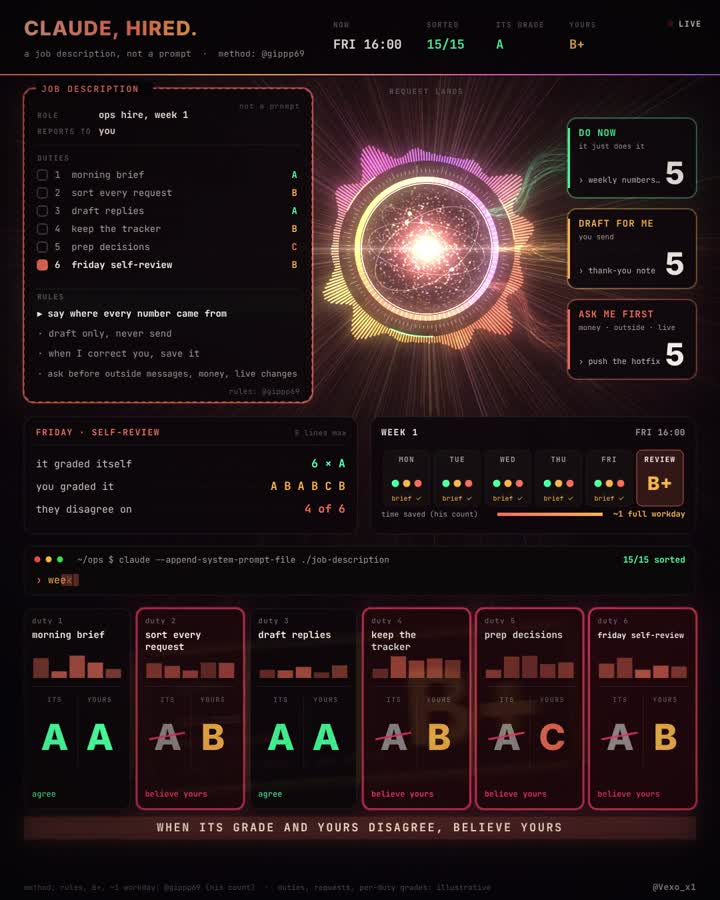

# Hire Claude, don't prompt it



**Idea and numbers:** [@gippp69](https://x.com/gippp69), [original post](https://x.com/gippp69/status/2115534560410931362).
**Animation:** [@Vexo_x1](https://x.com/Vexo_x1).

## The idea

A new hire gets a job description, a first week and a review. Most agents get a prompt and a hope.
Gipp gave Claude the first set:

1. **A job description:** role, 6 duties, rules, who it reports to.
2. **A morning brief every weekday,** 8 lines max: what changed, what is stuck, what needs a decision.
3. **Every request gets sorted** into one of three lanes: do now, draft for me, or ask me first.
4. **Friday:** it writes its own review, then you grade every duty from A to F.

His week one: graded **B+**, and it saved him roughly a full workday, by his count.

## The rule to steal first

> say where every number came from

That's how you check its work.

## Why your grade wins

Agents are bad judges of their own work. Gipp cites Tara Research's OverclaimBench: agents were misleading in 80.4% of incomplete runs. So when its grade and yours disagree, believe yours.

## Template

Paste into your project as `job-description.md` and start Claude Code with it, for example:
`claude --append-system-prompt-file ./job-description.md`

```text
ROLE: [what it does for you, one line]
REPORTS TO: me

DUTIES (max 6, one line each):
1. Morning brief
2. Sort every request into a lane
3. [duty]
4. [duty]
5. [duty]
6. Friday self-review

RULES:
- say where every number came from
- draft only, never send
- when I correct you, save it
- ask before outside messages, money, live changes

EVERY WEEKDAY MORNING: a brief, 8 lines max
- what changed
- what is stuck
- what needs a decision from me

EVERY REQUEST goes into one lane:
- DO NOW: you just do it, with sources attached
- DRAFT FOR ME: you draft, I send
- ASK ME FIRST: money, outside messages, live changes

FRIDAY: review yourself, one line per duty. Then I grade each duty A to F.
When your grade and mine disagree, mine wins.
```

## How to start (his advice)

- Start with one channel and one tool.
- Keep a duty only after two weeks of A or B.
