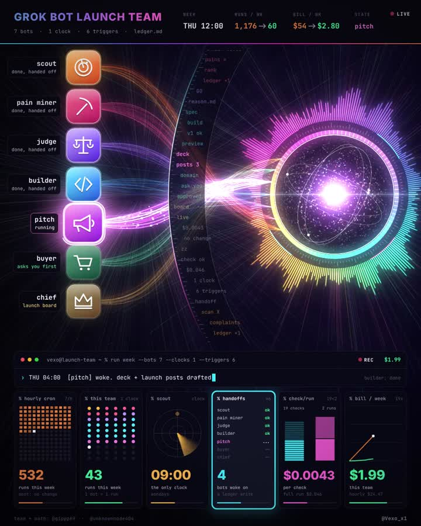

# Stop paying for empty runs



**Team setup and run count:** [@gippp69](https://x.com/gippp69). **Prices and audit prompt:** [@unknownnode404](https://x.com/unknownnode404).
**Animation:** [@Vexo_x1](https://x.com/Vexo_x1), [post](https://x.com/Vexo_x1/status/2115559892413243483).

## The problem

Put 7 bots on an hourly schedule and they wake up 7 × 24 × 7 = **1,176 times a week**.
Most of those runs ask "anything new?", get "no", and go back to sleep. You pay for every one.

## The fix: one clock, everything else on triggers

Gipp runs the same 7-bot launch team on **about 60 runs a week** (his math):

- **Monday 09:00** is the only clock. Scout scans X for what people complain about.
- Scout writes to one shared file. That write is the only thing that wakes the next bot.
- Pain Miner and Judge turn it into GO or KILL, with a written reason.
- Builder only wakes on GO and your "build".
- Pitch only wakes when there's something to pitch.
- Buyer finds the domain, then waits for you to approve the money.
- Chief keeps a live launch board.
- Saturday and Sunday: nothing to hand off, so nothing runs.

## What it costs

From unknownnode's numbers: a quick check costs **$0.0043**, a full run **$0.046**.
19 quiet checks cost less than 2 real runs. In his example, **$54 a week becomes $2.80**.

## The audit prompt

Prompt by [@unknownnode404](https://x.com/unknownnode404). Paste it into Grok Bot:

```text
Audit my routines against this tree:
1. List every routine with its schedule, trigger and monthly cost.
2. Sort each one into trigger, check plus clock, or night step.
3. Move every routine an event can announce off its clock.
4. Put a read-only hash check in front of every routine that keeps a clock.
5. Add Ask first rules for sending, publishing, purchases and deletes, and end night steps at a draft.
Show me the old and new monthly cost side by side. Nothing changes until I say go.
```

## Before you run it

- Nothing changes until you say go. Read the old vs new cost table first.
- Keep at least one clock, or nothing will ever start.
